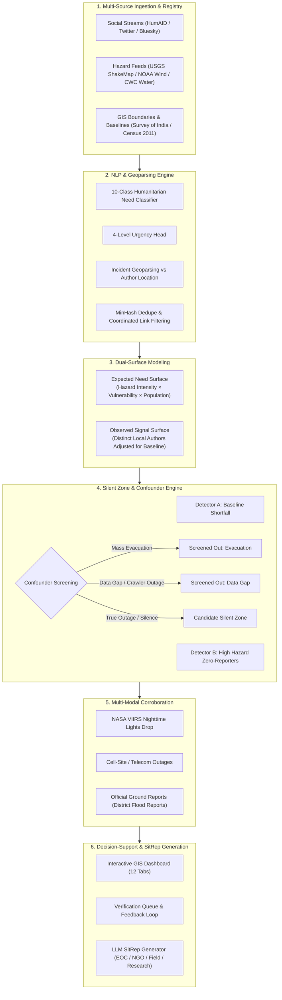

# CrisisLens: Finding Silent Zones in Disaster Social Media

[](https://nextjs.org/)
[](https://react.dev/)
[](https://www.typescriptlang.org/)
[](https://tailwindcss.com/)
[](https://www.python.org/)
[](LICENSE)

> **Computational Social Media Analytics — Final Capstone Project**  
> **Team (Group 14):** Asad Ahmad, Mohammad Yakub
> **Reference Report:** `output/CrisisLens_Project_Report_Group14_Alappuzha_ReferenceFormat.docx` (`.pdf`)

---

## 📌 Executive Summary & The "Loudness Bias" Problem

In the immediate aftermath of major natural disasters, emergency operations centers (EOCs), humanitarian agencies, and search-and-rescue teams increasingly rely on social media data to assess urgent human needs. Conventional disaster intelligence dashboards count message volume (tweets, distress calls, public posts) to gauge the severity of impact across geographic sectors.

**However, post volume reflects who *can* post, not who *needs help*.**

When an earthquake, hurricane, or catastrophic flood decimates electrical grids, downs telecommunication towers, and isolates communities, severely impacted areas experience a total communication blackout. Dashboards tracking raw message count exhibit severe **"Loudness Bias"**:
1. Well-connected urban centers with functional infrastructure flood social networks with thousands of messages, drawing disproportionate rescue and relief resources.
2. Severely devastated rural or disconnected districts go completely quiet online, rendering them invisible.
3. Simply flagging the quietest areas fails due to socio-economic digital divides — many rural regions maintain naturally low pre-disaster social media penetration.

### The CrisisLens Solution
**CrisisLens** detects **"Silent Zones"**: administrative units (districts, taluks, or villages) where the observed volume of verified local voices falls significantly below expectations given the modeled physical hazard intensity and the region's historical pre-disaster baseline activity.

```
Expected Need Surface (Hazard Severity × Vulnerability)
                      vs.
Observed Local Signal (Verified Local Authors adjusted for Baseline & Surges)
                      ↓
  Dual-Detector Silent Zone Engine + Confounder Screening
                      ↓
  Corroboration via Satellite Nighttime Lights & Telecom Outages
                      ↓
  Advisory Prioritization & LLM Situational Reports (SitReps)
```

---

## 🚀 Key Features

- **Multi-Hazard & Multi-Event Architecture:**
  - Evaluated across diverse disaster modalities: **Nepal 2015 Earthquake** (geological), **Hurricane Maria 2017** (meteorological / cyclone), and **Kerala Floods 2018** (hydrological).
  - High-resolution **Alappuzha Village-Level Prototype** modeling 93 revenue villages across 6 taluks with official Survey of India boundary polygons and Census 2011 attributes.
- **Robust 10-Class Humanitarian Need Ontology:**
  - Automated classification across: *Rescue & Trapped*, *Water & Sanitation*, *Medical & Injury*, *Food & Nutrition*, *Shelter & Displacement*, *Power & Energy*, *Telecom Outage*, *Road & Access Blocked*, *Missing Persons*, and *Protection & Safety*.
  - 4-level urgency scoring: *Informational (0)*, *Concerning (1)*, *Urgent (2)*, and *Life-threatening (3)*.
- **Incident Geoparsing & Amplification Network Pruning:**
  - Resolves *incident location* versus *author declared location*, preventing retweet cascades from distant capitals from distorting local damage estimates.
  - MinHash deduplication and coordinated link-sharing detection to filter spam, scams, and retweets, isolating unique human witnesses.
- **Dual-Detector Silent Zone Engine:**
  - **Detector A (Baseline Shortfall):** Flags units where local reporting voices collapse below their expected baseline given the regional surge.
  - **Detector B (High-Hazard Zero-Reporting):** Flags severely exposed units that register zero or near-zero local reports.
  - **Confounder Screeners:** Filters out expected lulls due to mass pre-evacuation or data ingestion gaps.
- **Multi-Modal Corroboration & Calibration:**
  - Fuses satellite nighttime lights radiance drops (NASA VIIRS VNP46A2 Black Marble) and mobile cell-site/telecom outage reports.
  - Reliability calibration curve and empirical confidence intervals for every flagged zone.
- **Interactive Decision-Support Dashboard:**
  - Built with Next.js 16 App Router, React 19, Tailwind CSS v4, and Radix UI / shadcn/ui.
  - Features 12 specialized analytical modules including interactive GIS maps, what-if simulators, crisis signature pattern analyzers, ablation harnesses, and persona-tailored LLM analyst briefs.

---

## 🏗️ System Architecture & Pipeline



---

## 📊 Dashboard Modules & Feature Breakdown

The web dashboard provides an end-to-end mission control center with 12 specialized navigation tabs:

| Tab / Module | Description | Key Capabilities |
|---|---|---|
| **Alappuzha Prototype** | High-resolution GIS map of Alappuzha, Kerala | Interactive map of 93 revenue villages across 6 taluks with Survey of India geometries, Census 2011 population overlays, and synthetic scenario demonstration. |
| **Overview Dashboard** | Comprehensive situational summary | Key indicators, regional severity, need distribution charts, and quickest-access alerts across selected disaster events. |
| **Silent Zones** | Advisory candidate ranking | Ranked candidates sorted by silent zone score, accompanied by Detector A/B flags, 95% confidence intervals, and confounder diagnostics. |
| **Critical Needs (No Reports)** | High-exposure zero-signal audit | Identifies sectors with high modeled physical damage that have registered zero local reports, categorized by likely cause (telecom failure, power loss, road cut). |
| **Need Ledger** | Real-time humanitarian need ledger | Structured inventory of extracted need units with urgency filters, author locations, and deduplicated post content. |
| **Patterns (Crisis Signatures)** | Co-occurrence pattern detector | Evaluates 8 compound crisis signatures (*Communication Collapse*, *Power+Telecom Cascade*, *Displacement Camp Crisis*, *Hospital Emergency*, *Supply Breakdown*, etc.). |
| **Analyse Posts** | Live text classification & geoparsing sandbox | Allows analysts to upload or paste custom disaster posts to inspect real-time need labels, urgency predictions, and geocoding. |
| **What-If Simulator** | Sensitivity analysis and threshold tuner | Interactive parameter controls to simulate changing damage thresholds, baseline multipliers, and evacuation offsets. |
| **Ablation & Evaluation** | Scientific benchmark & ablation harness | Compares 6 pipeline variants against gold-standard ground truth, proving the +50-point precision lift from baseline correction. |
| **Outage Evidence & Validation** | Satellite & telecommunication corroboration | VIIRS nighttime lights radiance drop scatter plots, Pearson correlation analysis, and empirical calibration reliability diagrams. |
| **Real Data Research** | HumAID corpus & pre-registration benchmarks | Performance evaluation across 76,484 real disaster tweets, holding out individual disasters to test cross-event generalization. |
| **LLM SitRep Brief** | Automated situational briefing generator | Generates structured briefs grounded strictly in pipeline evidence tailored for 4 target personas (*EOC Commander*, *Cluster Lead*, *NGO Field Team*, *Research Analyst*). |

---

## 🔬 Experimental Results & Validation

Tested on the CrisisLens evaluation suite (42 administrative districts across 3 major historical disasters, evaluated against frozen ground truth):

```
┌────────────────────────────────────────────────────────┬────┬────┬──────────┐
│ Model / Pipeline Configuration                         │ TP │ FP │ F1-Score │
├────────────────────────────────────────────────────────┼────┼────┼──────────┤
│ Raw Prototype (Rule Zero)                              │  4 │  1 │   0.53   │
│ Outage Evidence Only (No social signal)                │ 10 │  7 │   0.74   │
│ Post Volume Ranking ("Loudness Dashboard")             │ -  │ -  │ AUC 0.05 │
│ Full CrisisLens Pipeline (Baseline + Screening + Fusion)│  9 │  0 │   0.95   │
└────────────────────────────────────────────────────────┴────┴────┴──────────┘
```

> **Key Ablation Finding:** Removing baseline adjustment causes precision@K to plummet by **50 points**. Baseline normalization is the single most critical algorithmic defense against socio-economic bias in disaster informatics.

---

## 📁 Repository Structure

```text
crisislens/
├── .zscripts/                 # Deployment, service orchestration, and build scripts
├── admission-portal/          # Supporting legacy database configuration
├── analysis/                  # Python research, evaluation, and data pipeline
│   ├── boundaries/            # GeoBoundaries & Survey of India GIS boundary extractors
│   ├── crisislens/            # Core Python analytics library (classify, dedupe, pipeline)
│   ├── output/                # Generated research figures, tables, and baseline JSONs
│   ├── realdata/              # HumAID evaluation, Census 2011 joins, and Alappuzha audits
│   ├── build_report.py        # Generates formal Word (.docx) and PDF academic reports
│   ├── evaluate.py            # Primary evaluation script against gold-standard labels
│   ├── export_dashboard.py    # Exports Python pipeline outputs to dashboard JSON format
│   └── robustness.py          # 5,000-fold bootstrap resampler & timeline sensitivity
├── db/                        # Database storage and persistence
├── mini-services/             # Microservices and background workers
├── output/                    # Final project documents and reference format reports
├── prisma/                    # Prisma ORM schema (SQLite)
├── public/                    # Static web assets, geoJSONs, and imagery
├── src/                       # Next.js 16 full-stack web application
│   ├── app/                   # App Router pages and REST API routes
│   │   ├── api/events/        # 18+ REST endpoints for events, ablations, briefs, etc.
│   │   └── page.tsx           # Multi-tab unified dashboard
│   ├── components/            # UI components (shadcn/ui & custom CrisisLens views)
│   ├── hooks/                 # React state and data-fetching hooks
│   └── lib/crisislens/        # TypeScript port of the CrisisLens pipeline and datasets
├── CrisisLens_dataset_v1.xlsx # Master synthetic evaluation workbook (v1)
├── zones.csv                  # 93 Survey of India Alappuzha village geometries (EPSG:4326)
├── package.json               # Node.js / Bun dependencies
└── tsconfig.json              # TypeScript configuration
```

---

## 💻 Getting Started & Local Setup

### 1. Prerequisites
- **Node.js** v20+ or **Bun** v1.2+
- **Python** 3.10+ (with `pip`)
- **Git**

### 2. Frontend & API Setup (Next.js Dashboard)
```bash
# Navigate to project directory
cd crisislens

# Install dependencies
bun install
# or: npm install

# Generate Prisma client & initialize database
bunx prisma generate
bunx prisma db push

# Start the local development server
bun run dev
# or: npm run dev
```
Open [http://localhost:3000](http://localhost:3000) in your browser.

### 3. Python Evaluation & Analytics Pipeline
To run the evaluation benchmarks, generate research figures, and produce the formal academic report:
```bash
# Install Python scientific packages
pip install pandas openpyxl numpy scipy scikit-learn networkx matplotlib python-docx xlrd

# 1. Run pipeline evaluation and write results.json + output figures (~5-8 mins)
python analysis/evaluate.py

# 2. Export updated scenario outputs for the Next.js dashboard
python analysis/export_dashboard.py

# 3. Build the formal project report (.docx)
python analysis/build_report.py

# 4. (Optional) Run 5,000-resample bootstrap robustness check
python analysis/robustness.py

# 5. Run test suite
python -m pytest analysis/tests analysis/realdata/test_protocol.py -q
```

---

## 📡 REST API Reference

The Next.js backend serves over 18 structured endpoints:

| Endpoint | Method | Description |
|---|---|---|
| `/api/events` | `GET` | List all supported disaster scenarios and metadata |
| `/api/events/{id}/summary` | `GET` | Summary metrics, admin units, and ground-truth evaluation |
| `/api/events/{id}/silent-zones` | `GET` | List flagged silent zones and screened-out districts |
| `/api/events/{id}/silent-zones/{unit}/evidence` | `GET` | Granular multi-modal evidence drawer for a given unit |
| `/api/events/{id}/critical-needs` | `GET` | High-damage zero-reporter units with failure hypotheses |
| `/api/events/{id}/need-units` | `GET` | Deduplicated humanitarian need items (supports filtering) |
| `/api/events/{id}/patterns` | `GET` | 8 compound crisis signature co-occurrence detections |
| `/api/events/{id}/ablation` | `GET` | Precision@K comparison across 6 pipeline ablation variants |
| `/api/events/{id}/validation` | `GET` | Nighttime lights scatter plot, correlation, and reliability bins |
| `/api/events/{id}/per-unit-timeline` | `GET` | Temporal post volume series with pre/post-impact changepoints |
| `/api/events/{id}/brief` | `POST` | Generate persona-grounded LLM SitRep briefing |
| `/api/events/{id}/feedback` | `POST` | Record responder confirmation/refutation for live calibration |
| `/api/health` | `GET` | System health check and status verification |
| `/api/selfcheck` | `GET` | Consistency check between TypeScript engine and Python baseline |

---

## 📖 Academic Integrity, Scope & Evidence Transparency

- **Synthetic Evaluation Data:** The primary evaluation workbook (`CrisisLens_dataset_v1.xlsx`) and Alappuzha village workbooks are synthetic scenarios constructed to validate the algorithmic pipeline against uncorrupted, un-leaked ground truth. They demonstrate workflow and mathematical properties; they are not empirical historical findings.
- **Real-World HumAID Benchmark:** The HumAID evaluation uses 76,484 real humanitarian tweets to validate classifier accuracy across disaster types, proving real-world transferability of the vocabulary without claiming village-level silence truth.
- **Author vs. Incident Locality:** The geoparser strictly distinguishes between where a tweet was authored and the physical location of the crisis incident it describes, mitigating urban amplification.

---

## 👥 Contributors

**Group 14 — Computational Social Media Analytics:**
- **Asad Ahmad**
- **Mohammad Yakub**
- **Subhashit Pathak**
- **Lokesh Yadav**

For questions, academic inquiries, or contributions, please refer to the project documentation or open an issue on the repository.
